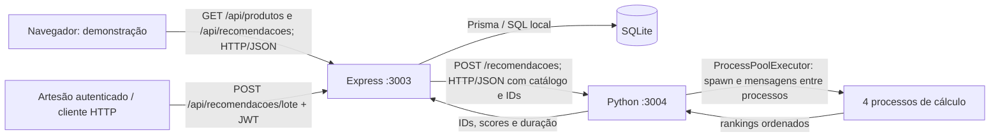

# Unidade 2 — arquitetura distribuída (critério 2.4)

## Serviços e comunicação implementados



Esta entrega é distribuída entre dois processos de serviço que se comunicam por
HTTP real. A avaliação foi local, na mesma máquina; não é um experimento entre hosts.
O navegador consome a demonstração em `/demonstracao`, servida pelo Express.
O frontend Next.js existente continua com seu contrato anterior e não foi migrado
integralmente para esta API. Não deve ser apresentado como integrado nesta entrega.

## Por que separar

| Módulo | Responsabilidade | Justificativa |
| --- | --- | --- |
| Interface de demonstração | Consultar catálogo e mostrar sugestões | Permite demonstrar a cadeia completa no navegador sem migrar todo o frontend |
| Express | Autenticação, autorização, validação, acesso aos produtos e composição da resposta | Centraliza as regras da loja e mantém o banco sob responsabilidade de um serviço |
| Python | Ranking de recomendações e processamento em lote | Isola trabalho de CPU do event loop do Node; permite ajustar a quantidade de processos independentemente |
| Processos de cálculo | Gerar o ranking de cada origem | Subtarefas independentes podem executar em núcleos distintos; não precisam virar microsserviços |
| SQLite via Prisma | Persistência relacional | Simplifica o desenvolvimento local; não foi exposto diretamente pela rede |

Não separamos autenticação, estoque e catálogo em serviços independentes: essa
complexidade não é necessária para o recorte da U2. SQLite continua adequado à
demonstração local, mas não estabelece uma estratégia de escrita para múltiplas
instâncias do backend. Escala horizontal do banco exigirá outra avaliação.

## Contrato

GET `/api/recomendacoes?produtoId=UUID&modo=sequencial&limite=4` é público.
O modo padrão é sequencial para uma única página: distribuir uma tarefa pequena
pode custar mais do que calcular diretamente.

POST `/api/recomendacoes/lote` exige JWT de ARTESAO e corpo
`{"modo":"paralelo","limite":4}`. Gera sugestões para cada produto disponível
do artesão autenticado, comparando-o ao catálogo disponível. O lote retorna os
resultados; não há persistência ou cache de sugestões nesta versão.

Express envia POST para `RECOMMENDER_URL/recomendacoes` com:

```json
{
  "produtos": [
    {"id":"a","descricao":"Vaso artesanal de barro","tecnica":"barro","regiaoProducao":"Olinda"},
    {"id":"b","descricao":"Prato artesanal de barro","tecnica":"barro","regiaoProducao":"Olinda"}
  ],
  "ids": ["a"], "modo": "paralelo", "limite": 4
}
```

Python retorna `modo`, `duracaoMs` e `resultados`, cada resultado com `produtoId`
e uma lista `itens` contendo `produtoId`, `score` e `motivo`. Express valida a
resposta e acrescenta os dados dos produtos encontrados no banco. Os UUIDs são os
mesmos nos dois serviços: não existe conversão inventada para os IDs p01 do BentoML.

O cálculo é determinístico: 50% correspondência de técnica + 20% correspondência
de região + 30% similaridade de descrição com `difflib.SequenceMatcher`.
Não é um modelo treinado nem usa o endpoint mock do BentoML original. O serviço
Python desta entrega é autocontido e usa somente a biblioteca padrão. O projeto
BentoML clonado anteriormente pode ser integrado futuramente por outro adaptador;
não precisa estar rodando para executar esta arquitetura.

## Limites e falhas

- Apenas produtos ativos e com estoque positivo entram no catálogo de recomendações.
- Limite de 2000 produtos e 20 sugestões por origem; corpo Python limitado a 2 MB.
- Timeout Express configurável (padrão 15 s); lote grande pode precisar de até 120 s.
- Falha/timeout remoto gera 503; resposta inconsistente gera 502. Não há fallback
  silencioso que pudesse esconder falhas ou distorcer o benchmark.
- No Python, no máximo dois cálculos HTTP são admitidos simultaneamente; excesso
  retorna 503. Há um pool compartilhado, sem criar pools por requisição.
- GET de recomendações: 60 chamadas/IP/minuto; lote: 6 chamadas/IP/minuto.
- Timeout do cliente não cancela trabalho de CPU já enviado aos processos.
- Python escuta apenas em loopback. O servidor HTTP padrão é para avaliação local;
  publicação em rede exige servidor apropriado e autenticação entre serviços.

Os testes automatizados iniciam um Python real, fazem a chamada Express → HTTP →
Python, comparam as versões, validam o lote e param o serviço para confirmar a
resposta 503 enquanto o catálogo permanece acessível.

## Relação com a Parte 1

Checkout transacional, fila de pedidos e Redis ainda não foram implementados neste
repositório. O enunciado os trata como pré-requisitos da Parte 1; eles não são
evidência produzida por esta entrega da U2. Não confundir ProcessPoolExecutor com
uma fila durável de negócio: seu estado não sobrevive ao encerramento do serviço.
